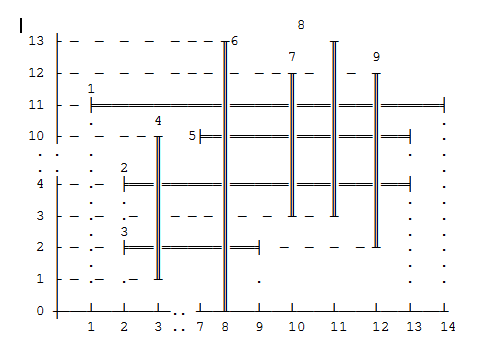

1. #4

На рисунке представлены 9 отрезков: четыре горизонтальные и пять вертикальных.   Опишите рисунок базой данных, состоящей из 9 фактов об отрезках.

       Для представления информации о каждом отрезке используйте терм seg/3, аргументами   которого являются номер отрезка и две точки point(X,Y). Напишите правило,   определяющее номер горизонтального отрезка. Голова правила представлена   термом horiz/1. Напишите  правило, определяющее номер вертикального отрезка.   Голова правила представлена термом vertical/1.

       Вопрос ?- horiz(N).

       Дает ответ N=1, N=2, N=3, N=5.

       Вопрос ?- vertical(N).

       Дает ответ N=4, N=6, N=7, N=8, N=9.

2.  #5

Введите в базу данных правило, определяющее пересекающиеся   отрезки. Голова правила представлена структурой cross/5, два  аргумента которой N и M - номера пересекающихся отрезков,  третий - point(X,Y), описывает точку пересечения, а четвертый    и пятый - длины пересекающихся отрезков. (Если необходимо, для нахождения квадратного   корня воспользуйтесь правилом sqrt(N,X), где N - число, X - квадратный   корень от числа N.)

       Вопрос

       ?- cross(N,M,point(X,Y),NL,ML)

       дает  несколько решений, одно из которых:

       N=4,M=2,X=3,Y=4,NL=9,ML=11.

 

3.  #6

Добавьте в базу данных правило определения периметра и площади   прямоугольников, образуемых пересекающимися отрезками.  Голова правила представлена структурой per_sq/6, четыре  аргумента которой - номера отрезков, образующих прямоугольник.  Пятый аргумент - P, периметр прямоугольника. Шестой аргумент -   S, площадь периметра.

        Вопрос

        ?-per_sq(A,B,C,D,P,S).

        дает решения, два из которых:

        A=4,B=2,C=6,D=3,P=14,S=10.

        A=6,B=1,C=7,D=5,P=6,S=2.