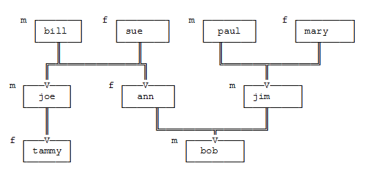

Для заданного дерева родственных отношений выполнить:

1. Создать базу данных для отношений parent,male,female.

2. Описать правило "Сын" son(X).

?-son(bob). дает true

?-son(ann). дает false

2. Описать правило «Бабушка»  grandma(X,Y).

?-grandma(mary,bob). дает ответ True.

?-grandma(ann,bob). дает ответ False.

?-grandma(tammy, mary). дает ответ False.

3. Описать правило «Внук» grandson(X,Y).

?-grandson (tammy,bill). false
?-grandson (bob,bill). true

4. Описать правило «Сестра» sister(X,Y).

?-sister (X,joe) дает ответ ann.

?-sister (jim,X) дает ответ -No.

5. Описать правило «Тетя» aunt(X,Y), используя правило sister (X,Y)

?-aunt(ann,tammy) дает ответ -Yes.

6. Описать правило «Кузин» cousin(X,Y). Кузин(а) - это двоюродный брат или сестра.

?-cousin(bob,tammy) дает ответ -Yes.

Приведенные ниже факты описывают хобби некоторой компании друзей:

       Ellen likes reading.

       John likes computers.

       John likes badminton.

       John likes photo.

       John likes reading.

       Leonard likes badminton.

       Eric likes swimming.

       Eric likes badminton.

       Eric likes chess.

       Eric likes game.

       Paul likes swimming.

        Необходимо:

7. Создать базу данных "Хобби".

 Предикат likes определяет отношение человек - хобби.

8. Определить правило four_hobbies(X) для тех, кто имеет четыре хобби.

9. Определить правило same_hobbies(X,Y) для нахождения тех, у кого одинаковые хобби.